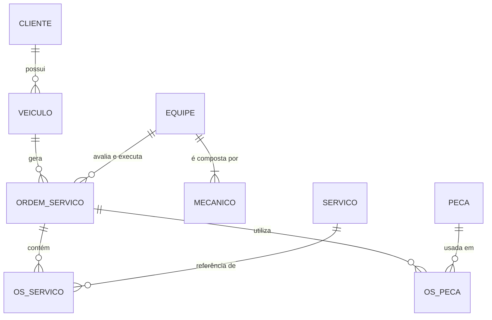

# 🔧 Projeto Lógico de Banco de Dados — Oficina Mecânica

Mapeamento do **esquema conceitual** de uma oficina mecânica para o **modelo lógico relacional** (MySQL 8), com script de criação, dados de teste e consultas SQL. Desenvolvido como desafio de projeto da DIO.

## Contexto

Sistema de controle e gerenciamento da execução de **ordens de serviço (OS)**. Clientes levam veículos para conserto ou revisão periódica. Cada veículo é designado a uma **equipe de mecânicos**, que identifica os serviços, preenche a OS com a data de entrega, avalia e executa. O valor de cada serviço vem de uma **tabela de referência de mão de obra**, o valor das peças compõe a OS, e o cliente **autoriza** a execução.

## Diagrama (modelo lógico)



## Tabelas

| Tabela | Chave primária | Chaves estrangeiras | Descrição |
|---|---|---|---|
| `cliente` | `id_cliente` | — | Dono do veículo (cpf único) |
| `veiculo` | `id_veiculo` | `id_cliente` → cliente | Placa única |
| `equipe` | `id_equipe` | — | Equipe de mecânicos |
| `mecanico` | `codigo` | `id_equipe` → equipe | Nome, endereço e especialidade |
| `servico` | `id_servico` | — | **Tabela de referência de mão de obra** |
| `peca` | `id_peca` | — | Valor unitário e estoque |
| `ordem_servico` | `numero_os` | `id_veiculo` → veiculo, `id_equipe` → equipe | Data de emissão, valor, status, datas de conclusão e autorização |
| `os_servico` | `(numero_os, id_servico)` | → ordem_servico, → servico | Serviços de cada OS |
| `os_peca` | `(numero_os, id_peca)` | → ordem_servico, → peca | Peças de cada OS |

## Decisões do mapeamento (conceitual → lógico)

1. **Relacionamentos 1:N** viram uma FK no lado N: `veiculo.id_cliente`, `mecanico.id_equipe`, `ordem_servico.id_veiculo` e `ordem_servico.id_equipe`.
2. **Relacionamentos N:M** (OS × serviço e OS × peça) viram tabelas associativas com PK composta e atributos próprios (`quantidade`, `valor_unitario`).
3. **Tabela de referência de mão de obra = `servico`.** O valor padrão fica nela; ao entrar na OS, é **copiado** para `os_servico.valor_unitario`. O mesmo vale para as peças. Assim, reajustes de preço não alteram OS antigas.
4. **Valor da OS.** `valor_total` guarda a soma de serviços + peças, mantendo o histórico. A query Q8 confere se o valor armazenado bate com a soma dos itens.
5. **Mesma equipe avalia e executa.** A OS referencia uma única equipe; os mecânicos que atuaram são os da equipe (Q15).
6. **Autorização do cliente** é modelada na própria OS (`autorizada` + `data_autorizacao`).
7. **Data de entrega = data para conclusão** (`data_conclusao_prevista`); `data_conclusao_real` registra quando terminou de fato.

## Constraints

- **PK** em todas as tabelas; **FK** em todos os relacionamentos, com `ON DELETE CASCADE` apenas nos itens da OS (`os_servico`, `os_peca`).
- **UNIQUE:** cpf do cliente, placa do veículo, nome da equipe, descrição do serviço.
- **CHECK:**
  - valores e estoque não negativos; quantidades maiores que zero;
  - `data_conclusao_prevista` e `data_conclusao_real` não podem ser anteriores à emissão;
  - **OS só pode estar em execução, concluída ou entregue se o cliente autorizou** (`chk_os_autorizacao`).
- **Status da OS:** `EM_ANALISE`, `AGUARDANDO_AUTORIZACAO`, `AUTORIZADA`, `EM_EXECUCAO`, `CONCLUIDA`, `ENTREGUE`, `CANCELADA`.

## Consultas SQL

O arquivo `02-queries.sql` traz 16 queries, cada uma com a pergunta de negócio que responde.

| Cláusula | Queries |
|---|---|
| `SELECT` simples | Q1 |
| `WHERE` | Q2, Q9 a Q14, Q16 |
| Atributos derivados | Q4 (idade do veículo), Q5 (prazo em dias), Q8 (total calculado), Q9 (ticket médio), Q13 (atraso), Q14 (peças faltantes) |
| `ORDER BY` | todas, exceto Q14 |
| `HAVING` | Q7, Q9, Q11, Q14 |
| Junções (`JOIN`, `LEFT JOIN`) | Q3 a Q12, Q14 e Q15 |

Algumas perguntas respondidas:
- Quantas OS cada cliente abriu, inclusive quem nunca abriu? (Q6)
- Quais equipes faturaram mais de R$ 1.100,00 em OS autorizadas? (Q9)
- Quais serviços e peças são mais usados? (Q10, Q11)
- Quais OS estão aguardando autorização do cliente? (Q12)
- As OS concluídas saíram no prazo? (Q13)
- Quais peças não cobrem as OS em andamento? (Q14)

## Como executar

Requer **MySQL 8.0.16+** (para o `CHECK` ser aplicado). No **DB Fiddle** (MySQL 8.0):

1. Cole o conteúdo de `01-esquema-e-dados.sql` no painel de cima (*Schema SQL*).
2. Cole **uma query por vez** de `02-queries.sql` no painel de baixo (*Query SQL*) e clique em **Run**.

Observação: a Q4 usa a data atual (`CURDATE()`) para calcular a idade do veículo; as demais usam apenas as datas dos dados de teste.

## Estrutura do repositório

```
├── README.md
├── 01-esquema-e-dados.sql
└── 02-queries.sql
```
